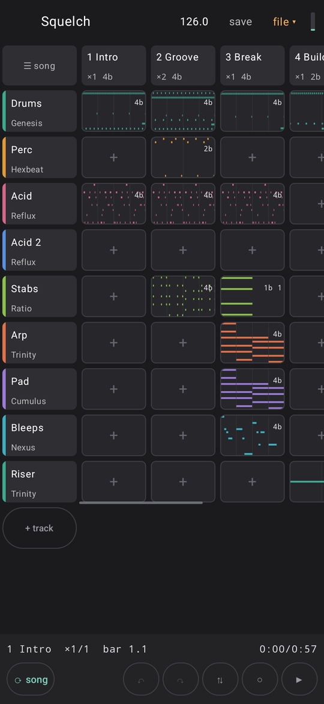
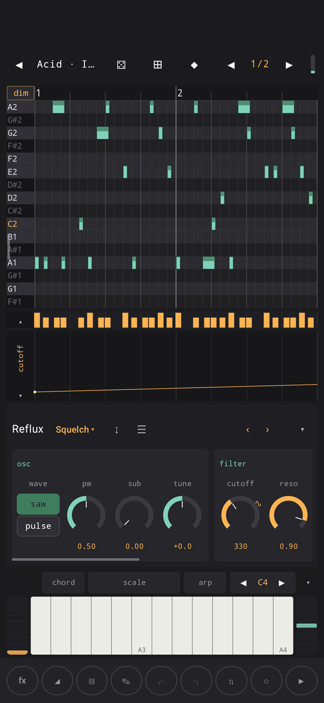
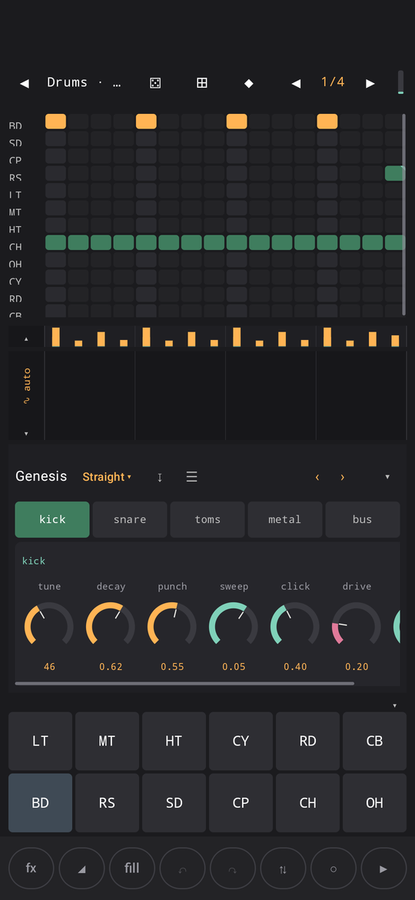
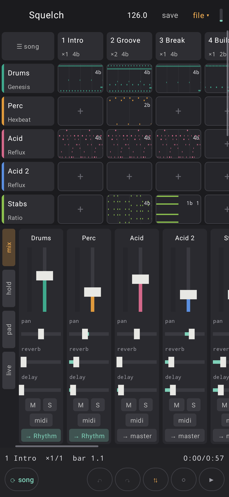
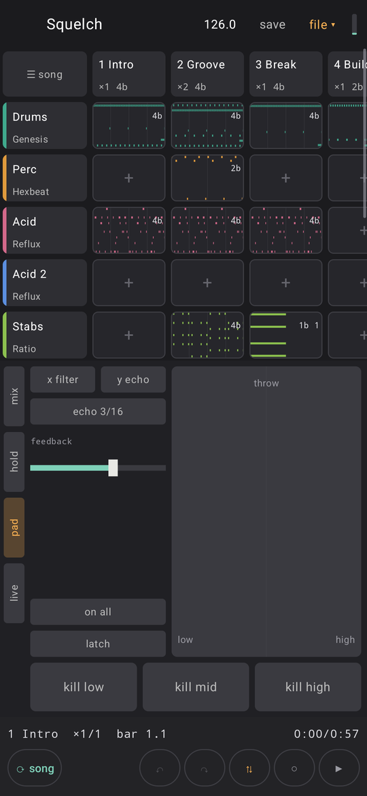
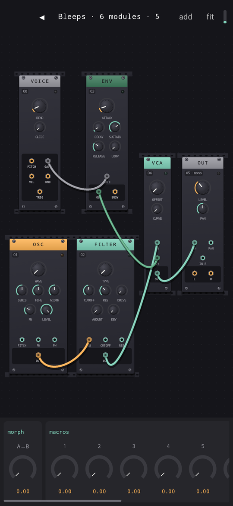
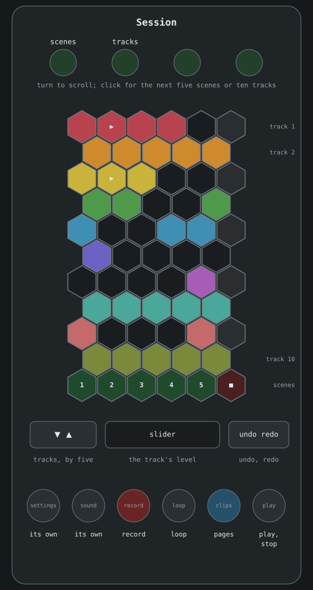
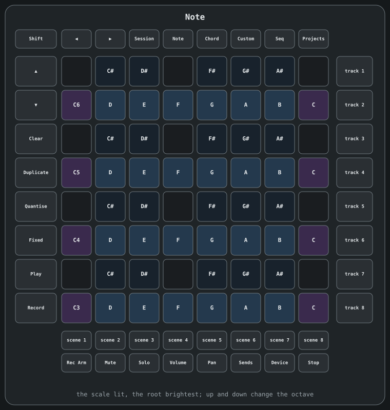

# Acidulous

Acidulous is a music studio for Android 8.1 or newer, Linux, Windows, macOS and browsers. Combine up to 16 synthesizers, drum machines, samplers and processors into scenes, then play them in order or launch clips as you go.

It's an homage to Caustic and a collection of things I've liked or wanted in other music tools. You can sequence, record, play live, change your voice and export songs or stems. It's nearly at 1.0 and ready for people other than me to test.

Let me know what works, what doesn't and what you'd like in #acidulous [on my discord](https://discord.gg/9Wun47jGC6), or open an issue here.

The [manual](manual/) is also in the app under Help….

Enjoy,<br>
Dan

---

## Screenshots

<table>
  <tr>
    <td align="center"></td>
    <td align="center"></td>
    <td align="center"></td>
  </tr>
  <tr>
    <td align="center"></td>
    <td align="center"></td>
    <td align="center"></td>
  </tr>
</table>

All six are the demo song, Squelch.

---

## What's in it

### Machines and effects

There are 31 machines. Each has patches to start from and a [manual page](manual/04-the-machines.md).

| Machine | What it does |
|---|---|
| Cumulus | Pads built from a spectrum of partials. |
| Formulate | An 8-bit chip synth with tables and formula waveforms. |
| Ratio | Six-operator FM with morphing algorithms. |
| Reflux | Acid bass with accents and slides. |
| Trinity | Three oscillators, wavetables, FM and voice drift. |
| Dice | Tempo-matched loop slicing with chance and repeats. |
| Forage | A drum machine with thirteen sample pads. |
| Genesis | Modelled drums with circuit drift and bus compression. |
| Hexbeat | Thirteen synthesized drum voices. |
| Palm | Modelled hand drums with different strokes and pressure. |
| Resonance | Eight struck objects that ring into each other. |
| Hammer | Modelled pianos, electric pianos and related instruments. |
| Manual | Two-manual organ, pedals and rotary cabinet. |
| Tine | Modelled bars, tines, pans and bells. |
| Filament | Strings you can pluck, pick, hammer, bow or blow. |
| Fret | Modelled guitars and basses with an amp. |
| Sympath | Strings with buzzing bridges and sympathetic resonance. |
| Brazen | Modelled brass, solo or in a section. |
| Chanter | Bagpipes and hurdy-gurdy. |
| Draw | Harmonicas, accordions and other free reeds. |
| Timber | Modelled woodwinds. |
| Tongue | Modelled jaw harps with mouth control. |
| Aviary | Modelled birdsong, from one bird or a flock. |
| Fathom | Water, weather and environmental sounds. |
| Molt | Record a voice and play it at drawn pitches. |
| Mosaic | SoundFonts, multisamples and granular playback. |
| Pollen | Grains from a file or live input. |
| Bias | Four audio recording tracks along the song. |
| Cipher | A vocoder with rearrangeable bands. |
| Diction | A vocal synthesizer trained on your voice. |
| Nexus | A modular synth built from the other machines. |

There are 29 effects, including filters, distortion, amps, dynamics, delays, reverb, modulation, pitch and frequency shifting, granular and spectral processing. Some follow the tempo, the signal or another track. Each has its own page in the manual.

### Mixing

- Two insert effects on every track, and two on the master before the limiter.
- Two send buses for the whole song. They start as a reverb and a delay but can hold any effect.
- Up to four groups in the mixer, to put tracks through the same effects and fader.
- Sidechains: the compressor, gate and filter can follow another track, like ducking the bass under the kick.
- A loudness meter (LUFS and true peak) on the master, and exports can be normalised to -14 LUFS.
- Three perform pages beside the mixer for playing a song live. Hold has beat repeat, gate, reverse, tape stop and a riser. Pad has an XY pad and kill switches. Live has mutes that wait for the bar, and fill. They work on the whole mix or one group, and they record into the song.

### Sequencing

- Songs are made of scenes. Clips in a scene can be different lengths, and scenes can repeat, change tempo or speed up and slow down.
- The same song as a clip launcher for playing live, where any empty cell is a looper.
- Piano roll and drum grid.
- Scale, chord and arp that act on notes as you play them in.
- Swing and tunings per song, with per-track overrides. Just, meantone and others are built in, or bring your own Scala files.
- Transpose a track, give it a fixed velocity or its own colour by holding its name.
- Automation, mod wheel and pressure lanes, and per-note pitch bend, pressure and slide.
- Probability, conditions, ratchets and micro-timing on single notes.
- Pattern generators for even rhythms, lines in key and mutating what's there.
- Step locks, so a knob can have its own value on chosen steps.
- Freeze a clip to audio to save CPU.
- Audio tracks (Bias) for recording over the song. A loop added to one follows the song's tempo.
- Two effect slots on the input, so you can record through an amp.

### Playing and syncing

- MIDI in over USB and Bluetooth LE, and MIDI out with clock.
- Sustain, sostenuto and soft pedals, recorded as lanes.
- MPE.
- Ableton Link, and MIDI clock in and out.
- Map any MIDI CC or note to any control.
- Game controllers, so the app can be used with no touchscreen.
- Built in, USB or Bluetooth keyboards: letters play notes, every control can be used from the keys, and every screen has shortcuts you can change in Settings.

### Controllers

Two controllers have special support, as I have these myself. Each has its own page in the manual.

| | |
|---|---|
| <a href="manual/07-midi-and-sync/exquis.md"></a> | <a href="manual/07-midi-and-sync/launchpad.md"></a> |
| [Exquis](manual/07-midi-and-sync/exquis.md) by Intuitive Instruments: its own playing with MPE, and the song grid, the mixer and steps on its pads. | [Launchpad Pro MK3](manual/07-midi-and-sync/launchpad.md) by Novation: notes, the song grid, steps, the mixer, chords and the perform effects. |

Either can be kept on its notes page, to play live while you change scenes and clips on the screen.

### Import and export

Export WAV, AIFF, FLAC, MP3 or AAC, as the whole song, one scene or stems, and MIDI files or a song bundle you can share.

Import MIDI files as a new song, with a machine picked for each part and General MIDI drums moved onto a drum machine. Song bundles open with their samples, and sounds go into the library. On a computer, preset files open from the file manager, and song zips with Open With (not with the AppImage, which doesn't add itself to the file manager).

Exports can go straight to the share sheet, and files shared to the app or opened with it get imported.

### Accessibility

Works with TalkBack. Every control says what it is and what it's set to, knobs and faders change with a swipe, and anything you'd hold is in TalkBack's actions menu. Everything can be done from a keyboard too, and there's a high contrast theme in Settings.

---

## Installing

Add [my F-Droid repo](https://hunke.ws/fdroid/repo?fingerprint=80438B253C257BCCE05CDCB9E3AC9B6174C2250659962B14FCBE7F32FD42D53E), then search for Acidulous. F-Droid offers new versions as updates.

Or get an APK from [Releases](https://github.com/roge-rm/Acidulous/releases). Use the usual 64-bit APK, or the 32-bit one for devices such as the Fire HD 8 that run 32-bit Android.

### Linux

On Debian 13 (Trixie), Ubuntu 24.04 and newer, and Raspberry Pi OS (64-bit),
the easiest way is my apt repo, so it updates with the rest of the system. Add
it once:

```
sudo curl -fsSLo /etc/apt/keyrings/hunke.asc https://hunke.ws/apt/hunke.asc
echo "deb [signed-by=/etc/apt/keyrings/hunke.asc] https://hunke.ws/apt stable main" | sudo tee /etc/apt/sources.list.d/hunke.list
sudo apt update
```

Then `sudo apt install acidulous`. It brings Java 21 with it.

Or from the [Releases](https://github.com/roge-rm/Acidulous/releases) page:

- Debian and Raspberry Pi OS: the `.deb` for your machine, amd64 or
  arm64. Install it with `sudo apt install ./acidulous_*.deb`.
- Other distributions (Ubuntu 22.04 and newer, Fedora, Arch, the Steam Deck):
  the AppImage, x86_64 or aarch64. It has its own Java, so just make it
  executable and run it.

### Steam Deck

Use the x86_64 AppImage. In Desktop Mode, download it, right-click it and turn
on **Is executable** under **Properties › Permissions**. Then add it to Steam
with **Add a Non-Steam Game** so it's in your library in Game Mode. It runs
full screen there, with the Deck's own controls, back buttons and touchpads.
The manual's [keyboard page](manual/11-keyboard.md) has what each one does.

### Windows

Windows 10 or 11, 64-bit. From the [Releases](https://github.com/roge-rm/Acidulous/releases)
page, run `acidulous-*-setup.exe`, or unzip `acidulous-*-windows-x64.zip`
anywhere and run `Acidulous.exe`. They aren't signed, so Windows will warn
you: choose **More info** and then **Run anyway**. If your audio interface has
its own low-latency driver, pick it in **Settings › audio › output**.

### macOS

macOS 11 Big Sur or newer. From the [Releases](https://github.com/roge-rm/Acidulous/releases)
page, get the .dmg for your Mac: **Apple Silicon (M1 and later)**
(`acidulous-*-macos-arm64.dmg`) or **Intel** (`acidulous-*-macos-x86_64.dmg`).
**About This Mac** in the Apple menu says which: a **Chip** line is Apple
Silicon, a **Processor** line is Intel. Open it and drag Acidulous into
Applications. Their sums are in `SHA256SUMS-macos`.

It isn't signed by an Apple developer account, so macOS won't open it the
first time. Try to open it once, then go to **System Settings › Privacy &
Security** and choose **Open Anyway**. On Big Sur and Monterey that's in
**System Preferences › Security & Privacy › General**. Or run this once in
Terminal:

```
xattr -dr com.apple.quarantine /Applications/Acidulous.app
```

### In a browser

[https://hunke.ws/fdroid/play/acidulous](https://hunke.ws/fdroid/play/acidulous/)

Chrome or Edge work best, since they have MIDI. You can install it from the
address bar, and after the first visit it works offline. Your songs are kept
in the browser.

## Building

You need the Android SDK and NDK. The NDK version is set in
`app/build.gradle.kts`.

```sh
./gradlew assembleDebug             # debug APK
./gradlew testDebugUnitTest         # unit tests
./gradlew -Parm32 assembleRelease   # the 32-bit APK
```

The desktop and browser versions build from the same code, on Linux, except
the macOS one, which builds on a Mac (GitHub builds both kinds, see
`.github/workflows/macos.yml`). The Linux and Windows packages need Docker,
and the browser's engine needs the Emscripten SDK.

```sh
./gradlew :desktop:run                          # run it on this computer
./gradlew :desktop:debAmd64 :desktop:debArm64   # the Debian packages
./gradlew :desktop:appImageAmd64                # an AppImage (appImageArm64 too)
./gradlew :desktop:windowsX64                   # the Windows installer and zip
./gradlew :desktop:macosDmg                     # the macOS .dmg, on a Mac
./gradlew :webApp:wasmJsBrowserDistribution     # the browser version
```

| | |
|---|---|
| Minimum Android | 8.1 (API 27) |
| Built against | API 37 |
| ABIs | `arm64-v8a`, `x86_64`; with `-Parm32`, `armeabi-v7a` and `x86` |
| UI | Kotlin, Compose |
| Engine | C++17 in `app/src/main/cpp`, with audio through Oboe on Android, miniaudio on the desktop and Web Audio in a browser |

## Testing

The engine tests run on the computer and take a few minutes:

```sh
tools/all_tests.sh
```

They check machine resets, repeatable rendering, sidechains, groups, modulation, factory patches and loudness readings. Export tests check that the lean quality setting doesn't change the output.

`tools/cpu_test.sh` measures what each machine and effect costs.

### Auditioning patches

`tools/audition.sh` plays a factory patch, writes a WAV and prints some
measurements (loudness, peak, brightness, attack and ring time). I use it
along with my ears when voicing the preset banks.

```sh
tools/audition.sh bank Trinity            # every patch in a bank
tools/audition.sh play Reflux Squelch     # one patch
tools/audition.sh params Mosaic           # the parameter table
```

---

## Licence

Acidulous is free software under the GNU General Public License, version 3 or later. See [LICENSE](LICENSE).

Copyright © 2026 Dan Hunke.

The third-party parts (Oboe, LAME, Ableton Link, asio, miniaudio, alsa-lib,
Steinberg's driver SDK and subsets of the DejaVu and Noto fonts) are listed
with their licences in [NOTICE](NOTICE), and you can read every licence in the
app's About window.

Everything else, including the engine, the machines and effects, the
sequencer and the file writers, was written for this project. No DSP code,
presets or samples come from anywhere else.

This was made using Claude Opus 5.0/5.5
